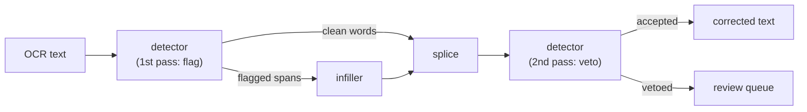

# arabic-postocr

Post-OCR correction for Arabic text. One model finds the errors, another
repairs only what was found.

```python
from arabic_postocr import Corrector

corrector = Corrector.from_pretrained()  # downloads from Hugging Face on first use
result = corrector.correct("سنن این ماجه - حدثنا علي بنمحمد")

print(result.text)     # سنن ابن ماجه - حدثنا علي بن محمد
```

## How it works



Arabic OCR fails on dots: `ب ت ث ن ي` share one skeleton, so a heavy scan turns
`حاتم` into `حامه` — often another valid word, which no dictionary can fix. But approaches
using a large language model (LLM) asked to rewrite a document can damage what it
touches. So for that we have a specific detector model where unflagged words are
copied byte for byte and only flagged spans are regenerated; damage is capped by
the detector's false-alarm rate (4.7% on our eval dataset). The price: an error the
detector misses is never repaired.

`gate` adds a second reading: the detector re-examines the output and vetoes
repairs it still objects to, reverting them and listing them in `result.hard`
for a human. It moves edit precision higher at a small recall cost.

## Results

1,000 held-out documents from 5 books absent from training, 947 real scans from
[freococo_books](https://huggingface.co/datasets/freococo/ocr_arabic_books) (*Musnad Ahmad*,
*al-Matalib al-Aliyah*) and 53 synthetic pages from
[synth_shamela](https://huggingface.co/datasets/freococo/synth_shamela_ocr_arabic_books).

| | CER reduction | precision | recall | F1 | damage |
|---|---:|---:|---:|---:|---:|
| detect → infill → splice | **+22.0%** | 59.1% | 49.4% | 53.8% | 3.7% |
| … with `gate=0.0` | **+21.3%** | **64.8%** | 48.5% | **55.5%** | 3.7% |

Per-source breakdown of the same run, on undiacritised text. *Better/worse/same*
group documents by CER change; *exact* counts outputs identical to ground truth:

| source | samples | CER in | CER out | reduce | better | worse | same | exact |
|---|---:|---:|---:|---:|---:|---:|---:|---:|
| freococo_books | 947 | 0.1253 | 0.0983 | 21.6% | 82.9% | 14.5% | 2.6% | 1.1% |
| synth_shamela | 53 | 0.1568 | 0.1128 | 28.1% | 90.6% | 7.5% | 1.9% | 0.0% |
| OVERALL | 1000 | 0.1269 | 0.0990 | 22.0% | 83.3% | 14.1% | 2.6% | 1.0% |

*Precision* is how many of its changes were correct. *Recall* is how many of the errors
present it fixed. *Damage* is how often it changed text that was already fine.

The infiller trained on two OCR engines' errors (PaddleOCR-VL + Tesseract), as type of erros
produced by VLMs can be quite different from character based OCR models.

## The review queue

With a gate set, `result.hard` lists words no repair satisfied; they are left as
the OCR wrote them.

```python
result = corrector.correct(text, gate=0.0)
for word in result.hard:
    print(word)          # ٦٦-٣١٦،   تيمية   الهجيمي   (٦٦٦)،
```

This can be integrated in a pipeline where a human double checks the hard cases.

## Install

```bash
pip install arabic-postocr
```

## Command line

```bash
arabic-postocr page.txt                                  # correct, print to stdout
arabic-postocr page.txt --gate 0.0 --review queue.txt    # + write the review queue
cat page.txt | arabic-postocr -  > fixed.txt             # pipe
arabic-postocr pages.jsonl --jsonl --field text -o out.jsonl
```

## API

```python
corrector = Corrector.from_pretrained(
    detector="g3ida/araelectra-arabic-ocr-detector",
    infiller="g3ida/arabart-arabic-ocr-infiller",
    device="cuda",          # default: autodetect
)

result = corrector.correct(text, threshold=0.5, gate=None, num_beams=1)
result.text       # corrected string
result.edits      # [Edit(original, corrected, index), ...]
result.hard       # words needing a human (empty unless gate is set)

results = corrector.correct_batch([t1, t2, t3], batch_size=16)
```

**`threshold`** is a logit, not a probability — 0.0 is p=0.5. Higher flags fewer words.

| threshold | precision | recall | false alarms |
|---:|---:|---:|---:|
| 0.0 | 93.8% | 89.8% | 6.2% |
| **0.5** | 95.3% | 87.7% | 4.7% |
| 1.0 | 96.6% | 85.5% | 3.4% |

**`num_beams=1`** is the default value.

## What this does not do

- Diacritics (tashkil) are preserved, never predicted. Unflagged words keep their original
  tashkil through the splice; flagged spans come back undiacritised.
- It will not fix all the errors, nor flag them all. Also it might messup with some correct predictions.
- It is not a spellchecker. It expects OCR output, and its notion of "wrong" comes from
  what OCR actually gets wrong, which is not the same distribution as human typos.

## Models

Hosted on the [Hugging Face Hub](https://huggingface.co/g3ida) and downloaded
automatically on first use (~1.1 GB):

| model | role | params | size |
|---|---|---:|---:|
| [g3ida/araelectra-arabic-ocr-detector](https://huggingface.co/g3ida/araelectra-arabic-ocr-detector) | AraELECTRA based — finds errors, then audits repairs | 135M | 518 MB |
| [g3ida/arabart-arabic-ocr-infiller](https://huggingface.co/g3ida/arabart-arabic-ocr-infiller) | AraBART based — repairs flagged spans | 139M | 535 MB |

Both are base-sized: 12 transformer layers at `d_model=768` for the detector, 6+6
encoder–decoder layers at `d_model=768` for the infiller. 274M parameters for the pair —
they fit together on a single consumer GPU, and run on CPU.

## License

Apache-2.0.

## References

- **AraELECTRA** — Wissam Antoun, Fady Baly, Hazem Hajj. *AraELECTRA: Pre-Training Text
  Discriminators for Arabic Language Understanding.* WANLP 2021.
  [arXiv:2012.15516](https://arxiv.org/abs/2012.15516) ·
- **AraBART** — Moussa Kamal Eddine, Nadi Tomeh, Nizar Habash, Joseph Le Roux, Michalis
  Vazirgiannis. *AraBART: a Pretrained Arabic Sequence-to-Sequence Model for Abstractive
  Summarization.* WANLP 2022.
  [arXiv:2203.10945](https://arxiv.org/abs/2203.10945) ·
